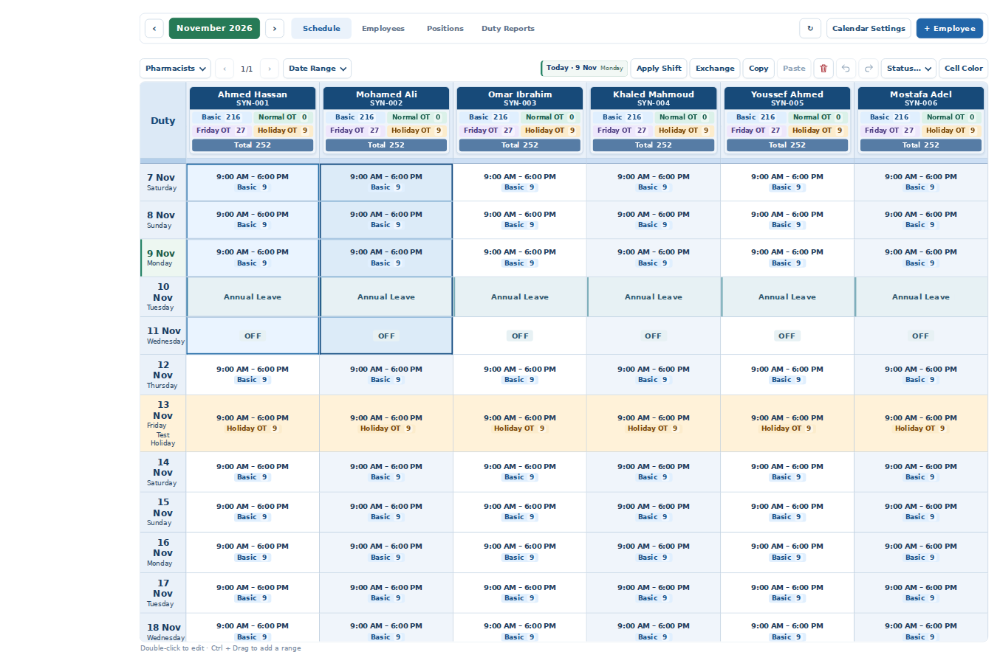
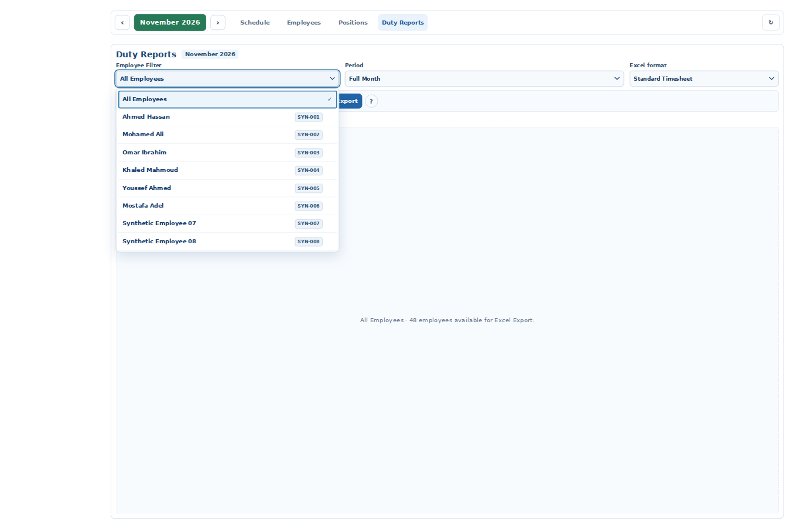

# Duty final UI refinements — 9 November 2026

**STAGING READY FOR USER TEST** — three UI changes only, continuing existing Draft PR #53. Accepted baseline: `67b5ce09492b7fb8fd9e2f7aec76028cd2c73d62`; branch `fix/duty-exchange-staging-20261109-v2`. Production main independently verified `c68a940fecd9d40b57b625769e9a4654991b6010`.

## Accepted baseline — USER VERIFIED / PASS

Product Owner explicitly confirms the interaction freeze fix, two-cell Exchange, Ctrl+Drag, two five-cell range Exchange, Undo/Redo and persistence after Refresh. These accepted behaviors are preserved; they are not reopened as unverified. The three refinements below await separate owner acceptance.

## Changes and boundaries

1. **Selection:** previous borders were derived from the union of selected cells, so the shared edge of adjacent gesture ranges disappeared. Boundary classes now compare gesture-range membership, while the selected keys/ranges are untouched. Every selected cell has a thin inner line; each range keeps independent blue outer edges. Range A uses `#eaf4ff`, B `#dcebf8`. Friday/Holiday/Leave backgrounds and OFF content remain; no widths, heights or geometry are changed by selection.
2. **Today:** a three-pixel green inset accent and very subtle green tint apply only to today's date header cell, plus a compact Today/date/weekday badge beside Apply Shift and Exchange. Shared `DutyControls.today()` uses `Asia/Riyadh`. One local timeout targets the next Saudi midnight; focus/visibility recovery also updates. The display updater patches only the date header/badge, preserves cell DOM/focus/editor/selection, cancels superseded timers and clears on scheduler cleanup. No data write, network polling or calculator change. Today outside the active month/custom range has no highlighted substitute.
3. **Reports Employee Filter:** a styled top-layer auto popover/listbox provides semibold names, same-row code badges, dividers, selected/focus/hover states and scroll. The hidden native select remains the value/change adapter used by the existing report selection path. The visible trigger gets focus after selection/Clear. Arrow keys/Home/End/Enter/Space, name typeahead, Escape, outside dismissal and Tab are handled. `beforetoggle` synchronizes the expanded state immediately. Popup positioning accounts for zoom and available viewport space. No report projection, copy values, workbook generation, permissions or source records change.

## Actual tests

| Verification | Result |
| --- | --- |
| Four new focused DOM/clock tests | **4 PASS**, included in Duty suite |
| All Duty + sleep/wake permission suite | **120 total: 118 PASS / 1 historical FAIL / 1 optional SKIP** |
| Relevant auth/session/permission regression subset | **42 PASS / 0 FAIL** |
| Previously passing Exchange real-pointer Chromium runner | **PASS**, unchanged: populated bidirectional five-cell Exchange, Ctrl+Drag, invalid ranges, Undo/Redo, actual idle-resume guard and reload |
| New real Chromium UI runner | **PASS**: independent adjacent ranges, unchanged cell geometry, Saudi midnight, wake date recovery, month/custom range exclusion, Friday and Holiday background preservation, OFF/leave, 48-employee scrolling, selection visibility, keyboard/mouse/outside/Escape/Tab; **0 writes**, unchanged synthetic data and no page errors |
| Zoom and visual evidence | **PASS** at 100%, 80%, 75%, first using CSS zoom and then Chromium viewport/DPR rendering equivalent to desktop browser zoom. Layout viewport and DPR asserted; direct CDP captures below. Agent visual review completed. Not a manual Windows browser-menu acceptance claim |
| Default and allowlisted Staging Preview builds | **PASS**; no changes to deployment fencing, backend settings or dependencies |

The retained failure is `tests/duty-release-isolation.test.cjs`'s old protected-file byte snapshot at `js/app.js`, already independently reproduced on untouched main during baseline preparation. The optional external online-template fixture remains skipped. Neither check was edited, disabled or relabeled PASS. Current CI evidence and final tested SHA/Preview identity are pinned in PR #53. No whole-suite-green claim.

A browser test initially caught stale expanded state after native outside dismissal; using the synchronous `beforetoggle` event fixes it. Fractional zoom rounds CSS border widths to physical pixels; the visual test verifies at least one physical pixel on each touching range edge, rather than assuming a nominal CSS border string. These test findings are resolved in the final UI.

## Visual evidence — synthetic records only

| Zoom | Schedule: separated ranges + today | Reports: styled listbox |
| --- | --- | --- |
| 100% | [Schedule](ui-20261109/schedule-100.png) | [Reports](ui-20261109/reports-100.png) |
| 80% | [Schedule](ui-20261109/schedule-80.png) | [Reports](ui-20261109/reports-80.png) |
| 75% | [Schedule](ui-20261109/schedule-75.png) | [Reports](ui-20261109/reports-75.png) |

## Exact changed files versus accepted baseline

Runtime and asset cache keys:
- `css/duty.css`
- `js/duty-controls.js`
- `js/duty-schedule.js`
- `js/duty-reports.js`
- `index.html`

Verification:
- `tests/duty-final-ui.test.cjs`
- `tests/duty-final-ui.browser.cjs`

Documentation:
- `PHARMFLOW_CURRENT_CHECKPOINT.md`
- `PHARMFLOW_CHANGELOG.md`
- `PHARMFLOW_TEST_MATRIX.md`
- `docs/duty/CURRENT_CHECKPOINT.md`
- `docs/duty/UI_REFINEMENTS_20261109.md`

Screenshots:
- `docs/duty/ui-20261109/schedule-100.png`
- `docs/duty/ui-20261109/schedule-80.png`
- `docs/duty/ui-20261109/schedule-75.png`
- `docs/duty/ui-20261109/reports-100.png`
- `docs/duty/ui-20261109/reports-80.png`
- `docs/duty/ui-20261109/reports-75.png`

## Three Product Owner acceptance tests

1. At Chrome 75%, 80% and 100%, Ctrl+Drag two adjacent employee ranges (one-cell and five-cell cases). Check individual lines and the vertical separation. Exchange, Undo/Redo and Refresh must retain accepted behavior.
2. Check the Today badge and green left accent. Change month/custom range to exclude today: no other row should be highlighted. Check Friday/Holiday and OFF/Leave remain readable.
3. In Duty Reports open Employee Filter; choose by mouse and keyboard, Escape/outside close, scroll a long list, then Clear. Verify one employee Copy Values and individual/All Employees Excel retain the selected month/range.

Remaining: owner visual acceptance on actual Windows Chrome. Hosted authenticated data was not edited or used for exploratory testing. No database migration, Edge Function, operational data, Production branch/deploy, Receiving/Expiry/Handheld/Global GTIN/auth runtime change. Stop after Staging delivery.
