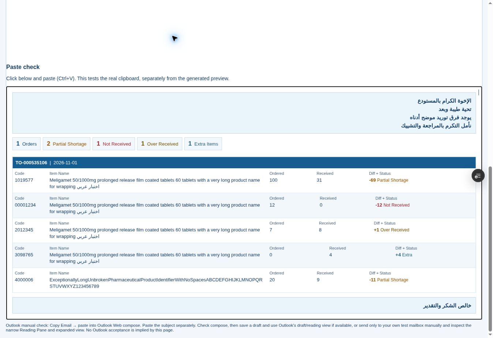
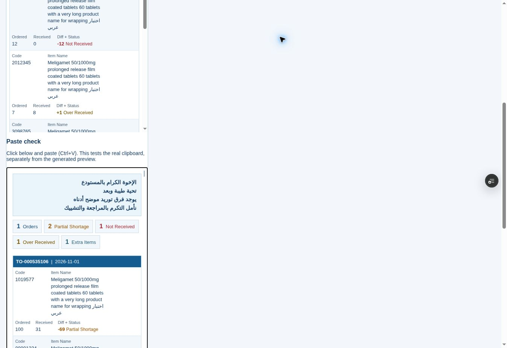

# Browser QA — 1 November 2026

Verified on Vercel Preview deployment dpl_2ja8zUDEEAQMdyXgCtKfJTzEpn8p, runtime/fixture commit 6089b3bbc40eeaba7bb3fd883a08406a14948ed8. Later final change adds last-resort wrapping for unusually long item codes, with the same layout; 21 focused tests and both builds rerun PASS.

URL: https://pharmflow-test-q0c6j1ox7-fhyh2xtskz-3504.vercel.app/staging/receiving-email-acceptance.html

- Actual Copy Email clicked. Browser reported rich copy successful. The page's separate Inspect copied email action called navigator.clipboard.read/getType and rendered the HTML read back from the clipboard, independently of the preview renderer. Both text/html and text/plain present. Five-order clipboard HTML: 31,618 characters (browser-normalized); one-order: 17,906. No scripts, frames, external images or active objects in the copied content.
- Browser automation's virtual clipboard was separate/empty, so automated Ctrl+V was unavailable. The native browser Clipboard API readback was used instead. This does not claim native Ctrl+V or Outlook sanitization PASS.
- Measurements below refer to the actual clipboard HTML rendered in the editable paste area, not PharmFlow's iframe preview.

| Pane | Content width / scrollWidth | Code + Name | Quantities | Header height |
|---|---|---|---|---|
| 320px | 318 / 318 | same row | below | 19px |
| 380px | 378 / 378 | same row | below | 19px |
| 600px | 598 / 598 | same row | alongside | 19px |
| Full 1316px | 1314 / 1314 | same row | alongside | 19px |

No horizontal overflow at these widths, no vertically broken column headers; first name block grows from 250px to 704px at full width. Long natural names wrap at spaces; the deliberately unbroken identifier wraps only within its name cell. Over/Extra distinct, signed differences retained. Browser screenshots show copied HTML, not Outlook.

- Browser subject check: one order `فرق توريد | TO-000535106`; two orders `فرق توريد | TO-000535106 + TO-000532448`; five orders `فرق توريد | TO-000535106 + 4 أخرى | 01-11`.
- Partial-only scenario copied/read back: only Orders=1 and Partial Shortage=1, with other KPIs absent.
- Corporate Outlook compose/narrow Reading Pane/full-width: NOT VERIFIED; Product Owner manual acceptance required per ACCEPTANCE.md.
- Default local Sites preview was unavailable because the managed route hostname was rejected by Vite allowedHosts. No application/network settings were changed to bypass it; browser QA used the deployed Vercel Preview.

