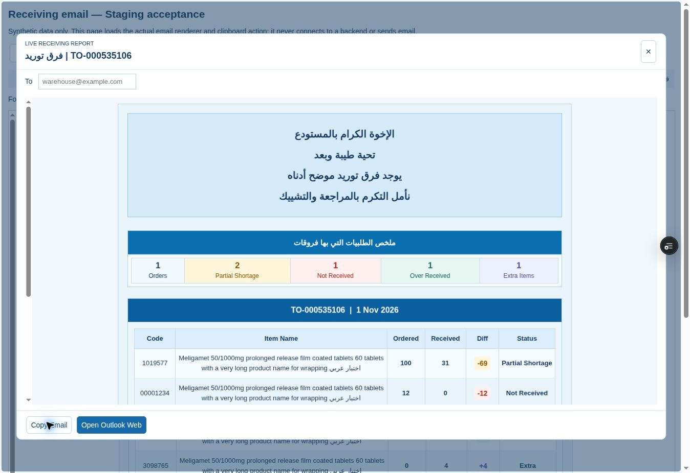

# Original-style email browser verification — 1 November 2026

Tested runtime: fd50498c5f2654483606d2c0220076cd155cd90e, Vercel Preview dpl_HEXxvmm4u6ZoQ4DcSrXNXwndqyNn. Same existing Staging branch, no backend writes.
Tested URL: https://pharmflow-test-57ptnj54k-fhyh2xtskz-3504.vercel.app/staging/receiving-email-acceptance.html

## Verified browser behavior

- Open PharmFlow preview invokes the actual application dialog/renderer with synthetic data; the fixture supplies only shell styling. Original blue backgrounds, centered Arabic intro/closing and blue section bars restored. Exactly six headers per order: Code, Item Name, Ordered, Received, Diff, Status. One compact KPI row, no large/two-row cards. Same full HTML document goes to iframe srcdoc and ClipboardItem (unit equality check).
- Existing Copy Email inside the actual preview reported Formatted email copied: Async Clipboard write resolved. Browser clipboard.read was denied, and the cloud-managed virtual clipboard was empty; OS clipboard MIME readback and actual native Ctrl+V were NOT verified in this run. No clipboard seeding, DOM selection or hidden-content workaround was used. Unit tests captured and inspected the exact HTML/plain ClipboardItem bytes; this is transport-generation evidence, not a real Outlook paste.
- Open Outlook Web opens a separate browser tab with the safe Microsoft 365 HTTPS compose route and synthetic short subject, then reaches Microsoft's Sign in page. No account selected or credentials entered. Authenticated compose, subject/recipient persistence through corporate SSO, saved/reopened drafts and actual Outlook rendering remain UNVERIFIED.
- User-entered recipient/subject encoding, separate-tab noopener/noreferrer, absence of rich body/account hint/send parameters, and preservation of clipboard during Outlook action are unit-tested.

## Width / direction / alignment

Measurements refer to the exact email HTML in the sandbox preview, NOT an Outlook pasted body.

| Pane | Body width / body scrollWidth | Compact KPI viewport / scrollWidth | Detail viewport / scrollWidth |
|---|---|---|---|
| 320px | 305 / 305 | 229 / 370 | 217 / 560 |
| 380px | 365 / 365 | 289 / 370 | 277 / 560 |
| 600px | 585 / 585 | 509 / 509 | 497 / 560 |
| Full width | 1301 / 1301 | 844 / 844 | 832 / 832 |

Horizontal overflow is bounded within the relevant region, not the full letter. Both scrollers use LTR and start at scrollLeft=0, so Code/Name are initially visible. Six columns remain intact at every tested width. All headers stay one line (39px height); normal names wrap at spaces, pathological unbroken names within their own cell. All nonempty cells explicitly centered. The deliberate tradeoff is horizontal table/KPI scrolling in narrow panes, never text shrinkage or column stacking; Outlook preservation of this behavior is still pending.

| Scenario | KPI values | Orders / six-column tables |
|---|---|---|
| Unassigned Extra only | Extra=1; Orders hidden | 1 detail section, zero identified orders |
| Partial only | Orders=1, Partial=1 | 1 table of 6 columns |
| Several categories | Orders=1, Partial=1, Not Received=1 | 1 table of 6 columns |
| Two orders/all five | 2, 2, 1, 1, 1 | 2 tables of 6 columns |
| Five orders/all five | 5, 2, 1, 1, 1 | 5 tables of 6 columns |

Single KPI tr in all cases; zero categories absent. One/two/five-order subject convention verified. Header renders `TO-000535106 | 1 Nov 2026`; separate-order date selection and `30 Oct 2026` formatting are also unit-tested.

Actual browser Diff badge colors: -69/-11 amber #fff5da (Partial), -12 red #fff0ef (Not Received), +1 teal #e7f6f1 (Over), +4 purple #edf0ff (Extra). Each remains a separate Diff cell beside its explicit Status cell.

## Automated evidence and remaining gate

30 focused checks PASS: 16 email/preview/clipboard/Outlook-action/model checks, 12 Receiving multi-order regression and 2 report scope/performance checks. Final UI/direction adjustment reran all 16 affected email checks; Receiving/report inputs remained unchanged. Default and Staging builds PASS; served SHA/binding verified at delivery. No Production/data/DB/migration/Expiry changes.

PENDING OWNER: normal Copy Email -> Ctrl+V in authenticated corporate Outlook Web; save/close/reopen draft; narrow Reading Pane and expanded/full-width; preservation of backgrounds, borders, typography and table scrolling. No Outlook PASS or identical-rendering claim. Follow ORIGINAL_RESTORE.md. Stop for owner approval; no Production release/preparation authorized.

