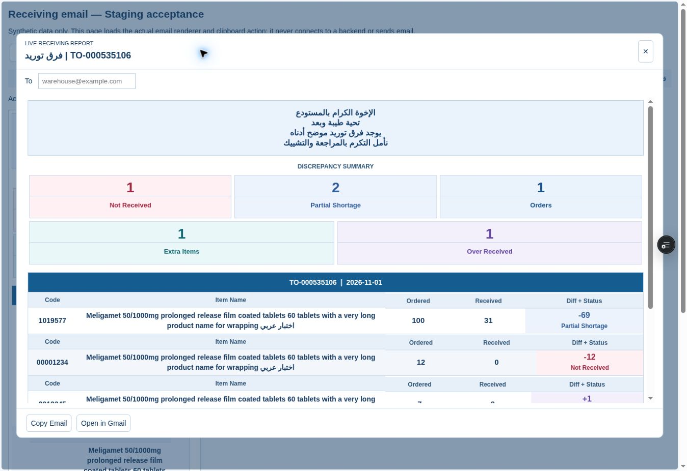
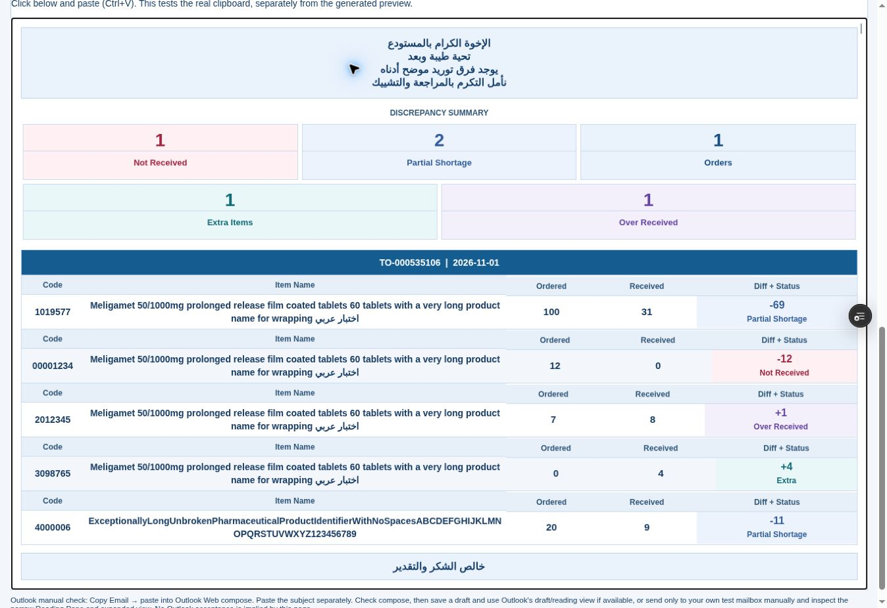
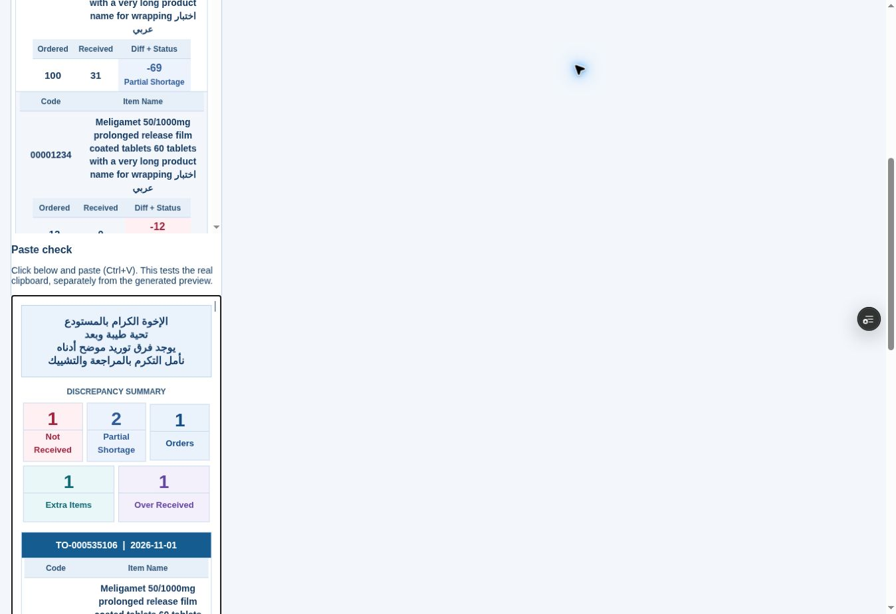

# Repaired email browser verification — 1 November 2026

Runtime/fixture tested: 2b2ef9ae78d51d1b61ded594712b279a0df97c10, Vercel Preview dpl_CZKEnzMjfUMmJSaBa175cNBE4eY9, Staging branch only.
URL: https://pharmflow-test-dbrumwd5r-fhyh2xtskz-3504.vercel.app/staging/receiving-email-acceptance.html

## Verified

- Actual openFinalizedDiscrepancyEmailPreview function opened in the synthetic fixture; existing Copy Email button wiring exercised. Same renderer in sandbox iframe and clipboard HTML; no backend scripts loaded by fixture. The fixture supplies only the dialog shell styling.
- Actual copyFormattedReceivingEmail (Async Clipboard rich path) followed immediately by navigator.clipboard.read/getType within the same fixture click. Five-order HTML readback retained both text/html and text/plain, 107 bgcolor attributes and 117 explicit font elements (including body background). One-order readback retained 67 backgrounds and 69 font elements. This is actual clipboard readback, not an HTML string copied from the preview.
- The cloud browser's separately managed/virtual clipboard can restore stale contents across tool actions. Native fallback reported a handled copy event but subsequent cross-action read observed old content; native clipboard persistence/physical Ctrl+V is therefore NOT verified by this environment. Async rich write/read in the same user gesture verified the current payload. No virtual clipboard seeding was used to manufacture a paste result. Native fallback event/cleanup and rejection behavior were unit-tested.
- All nonempty copied cells centered; nine palette colors preserved in HTML. No active content/external trackers. Mixed Arabic/English names, leading-zero code and long unbroken token displayed without overlap.

| Pane | Client / scroll width of clipboard rendering | Detail flow |
|---|---|---|
| 320px | 318 / 318 | quantities below Code + Name |
| 380px | 378 / 378 | quantities below Code + Name |
| 600px | 598 / 598 | quantities below Code + Name |
| Full 1316px | 1314 / 1314 | quantities alongside Code + Name |

Headers stayed on one line (29.5px height); no horizontal overflow at these tested widths. Full-width name block grew to 744.7px; at narrow widths it was 280px. Natural names wrap at spaces; pathological tokens wrap inside their own cell.

| Scenario | Aggregate KPI values (Orders, Partial, Not Received, Over, Extra as present) | Summary sections |
|---|---|---|
| Unassigned Extra only | Extra=1; Orders absent | 1 |
| Partial only | Orders=1, Partial=1 | 1 |
| Several | Orders=1, Partial=1, Not Received=1 | 1 |
| One order, all five | 1, 2, 1, 1, 1 | 1 |
| Two orders, all five | 2, 2, 1, 1, 1 | 1 |
| Five orders, all five | 5, 2, 1, 1, 1 | 1 |

One/two/five-order subjects match the approved short convention. The repeated Meligamet code across orders counts once in the Partial KPI; details retain all per-order rows. Zero categories absent. Full-width and 320px screenshots are of HTML read back from the clipboard; the preview screenshot is the actual app preview function in the isolated fixture.

## Explicit acceptance limits

No authenticated corporate Outlook session was available. Outlook Web Compose Ctrl+V, saved draft closed/reopened, narrow Reading Pane, and expanded Outlook remain NOT VERIFIED / OWNER ACCEPTANCE PENDING. HTML-attribute resilience checks and browser screenshots do not establish Outlook sanitizer behavior. Follow REPAIR.md's minimal manual test. No Production release or preparation authorized.

