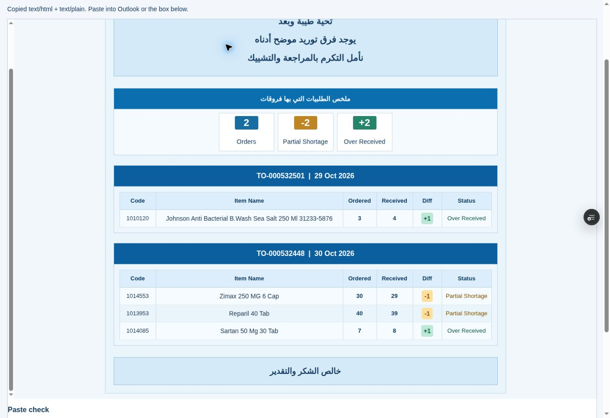

# Final email refinement browser QA — 2 November 2026

Runtime tested: db62a7220f8cf9a67ebf4fc5ce4d50a2a9366f62; Vercel Preview dpl_CpWgYCx2j3hvZQCdKt8W74MWVKbj, same isolated Staging branch.
URL tested: https://pharmflow-test-ora2kgyt3-fhyh2xtskz-3504.vercel.app/staging/receiving-email-acceptance.html

## Actual browser measurements

| Scenario | Displayed unit KPIs | Actual card sizes | Group width |
|---|---|---|---|
| Two indicators | 2 Orders; +2 Over | 124 × 86px each | 264px |
| Approved main example | 2 Orders; -2 Partial; +2 Over | 124 × 86px each | 396px |
| Five indicators | 2; -2; -12; +2; +3 | 124 × 86px each | 660px |
| Larger quantities | 2; -240; -412; +2500; +75 | 124 × 86px each | 660px |

Every card shared the same y coordinate within each scenario. All card backgrounds computed rgb(255,255,255); solid backgrounds are confined to number badges. The 84px declared table height renders 86px including its content/border geometry consistently, including the +2500 case. Fewer cards do not grow or stretch.

Approved fixture dates rendered correctly: TO-000532501 | 29 Oct 2026 and TO-000532448 | 30 Oct 2026. Six columns per order. Johnson name is one line at full width and two lines at the 640px minimum table (font bounding height 16px vs 36px, line height 20px). Zimax, Reparil and Sartan remain one line in both measurements. Computed name font weight 400. Status normal-weight/classification color and stronger Diff tints verified by the focused DOM tests.

| Available pane | Body client / scrollWidth | KPI client / scrollWidth (five) | Detail client / scrollWidth |
|---|---|---|---|
| 320px | 305 / 305 | 241 / 660 | 217 / 640 |
| 380px | 365 / 365 | 301 / 660 | 277 / 640 |
| 600px | 585 / 585 | 521 / 660 | 497 / 640 |
| Full width | 1301 / 1301 | 856 / 856 | 832 / 832 |

Cards retain 124×86px and one row at every tested width. Horizontal overflow is bounded inside the KPI/detail regions; the letter does not expand. This deliberately requires horizontal scrolling in narrow panes. No text shrinking, multiple KPI rows or six-column stacking was introduced.

## Copy and Outlook status

The supported Clipboard API rich-copy function and Open Outlook Web action are unchanged from the owner-tested baseline. Browser Copy Email returned the rich success message. HTML/plain MIME payloads and exact preview/clipboard document equality are covered by tests. No substitution of plain text on successful rich copy.

The owner has confirmed that rich Ctrl+V formatting largely works in corporate Outlook on baseline 218e2bd. This is retained as owner evidence only. No authenticated corporate Outlook session was provided for independent testing of the new badges/spacing; the previously observed cloud Outlook action reached Microsoft sign-in. No repeat authentication/settings investigation or clipboard workaround was performed. This screenshot shows the browser's authoritative email renderer, NOT an Outlook pasted message.

Remaining OWNER acceptance: refined report pasted in New Mail; save and reopen draft; narrow Reading Pane; expanded/full-width view; badge colors, equal sizing, Diff colors and signed UNIT values. Outlook can normalize inline styles or scrolling; do not claim exact compatibility without that check.

## Technical checks

34 focused checks PASS: 20 email/model/fixture/HTML/clipboard/Outlook-action, 12 Receiving multi-order regressions, 2 report scope/performance. Final slot sizing adjustment reran all 20 affected email checks and both builds; the 14 regression checks use unchanged inputs. Default and exact-branch Staging builds PASS. No operational data, database, allocation, Receiving business logic, Expiry or Production changes. Served SHA/Staging binding verified at delivery.

